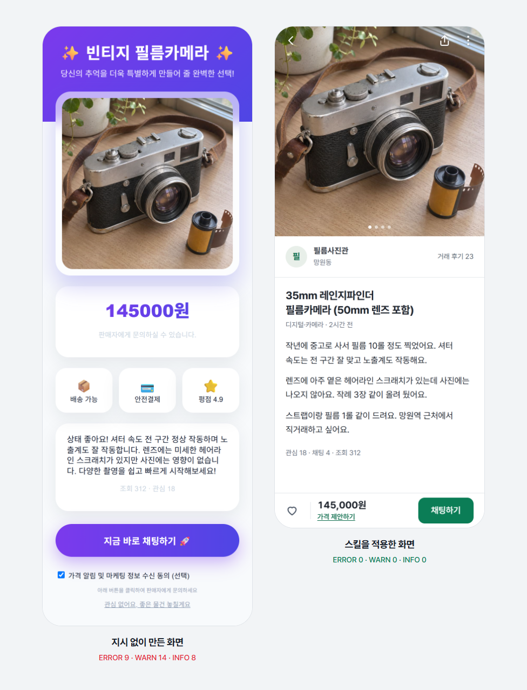
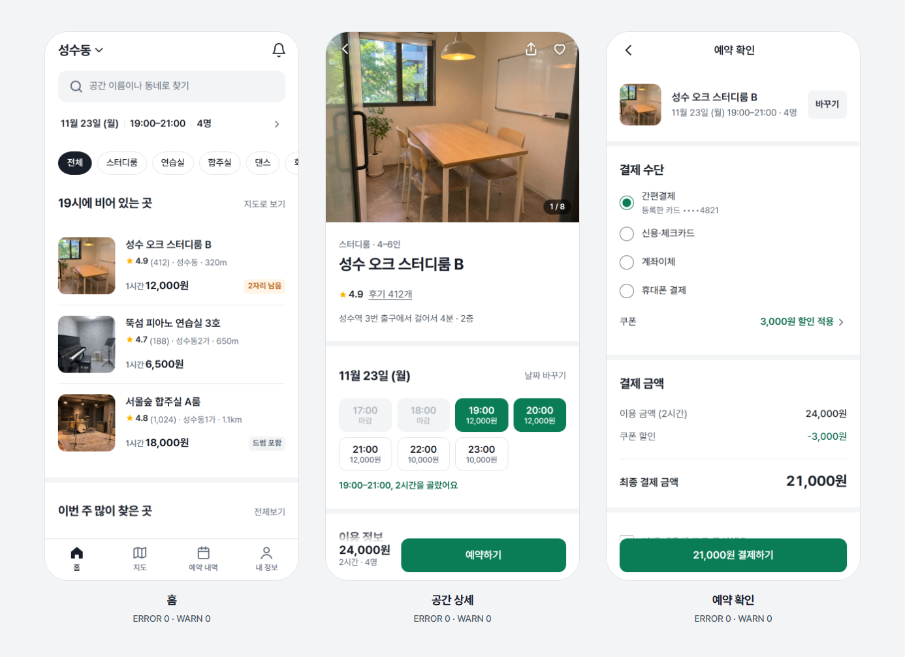
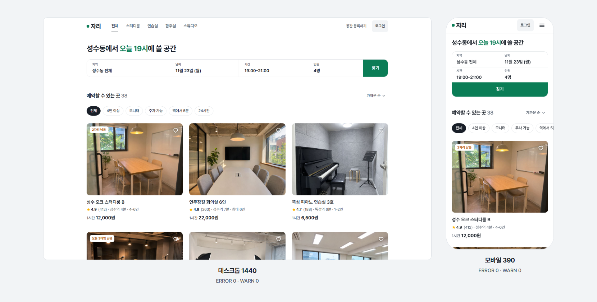

# korean-product-ui

한국어 서비스 화면을 만들 때 쓰는 skill입니다. 한국 사람이 봤을 때 실서비스처럼 보이도록 만들고, 다 만든 화면을 실제 브라우저로 그려서 한글 줄바꿈, 금액 표기, 말투, 대비, 터치 영역, 다크패턴을 검사합니다. 앱 화면, 모바일 웹, 데스크톱 웹이 대상이고 공공·관리자 화면은 다루지 않습니다.

아무 지시 없이 만든 중고거래 상세 화면(왼쪽)과 이 skill로 만든 화면(오른쪽)입니다. 사진은 같고, 아래 숫자는 검사기 결과입니다.



왼쪽 화면을 검사하면 이렇게 나옵니다(일부).

```
$ node scripts/check-ui.mjs examples/market-before.html --viewport mobile

[mobile 390×844] ERROR 9 · WARN 14 · INFO 8
  ERROR ko-midword-break     어절 중간에서 줄이 바뀝니다: "노|출계도" (word-break: keep-all 필요)  (p.desc)
  ERROR num-comma            1,000 이상 금액에 쉼표가 없습니다: "145000원" → "145,000원"  (div.price)
  ERROR contrast             글자 대비 1.48:1 (4.5:1 이상 필요): "판매자에게 문의하실 수 있습니다."  (p.muted)
  ERROR dark-prechecked      선택 동의 항목이 미리 체크돼 있습니다: "가격 알림 및 마케팅 정보 수신 동의 (선택)"  (input)
  WARN  ko-font-stack        한글 글꼴이 없는 글꼴 지정: Inter, "Helvetica Neue", Arial, sans-serif (…)  (h1)
  WARN  copy-tone-mix        해요체와 합쇼체가 섞여 있습니다. 예: "상태 좋아요!" / "판매자에게 문의하실 수 있습니다."  (body)
  WARN  dark-confirmshaming  거절하는 사람을 탓하거나 겁주는 문구입니다: "관심 없어요, 좋은 물건 놓칠게요"  (a.skip)
  WARN  ai-gradient          보라·남색 계열 그라데이션 배경: AI 기본 화면에서 가장 흔한 신호입니다  (div.hero)
```

## 사용법

```
git clone https://github.com/gumwoo/claude-skills.git
cp -r claude-skills/korean-product-ui ~/.claude/skills/
```

설치해 두면 한국어 서비스 화면을 만들어 달라고 할 때 Claude가 알아서 씁니다. 검사만 따로 돌릴 수도 있습니다.

```
/korean-product-ui check src/pages/subscribe.html
node ~/.claude/skills/korean-product-ui/scripts/check-ui.mjs http://localhost:3000/checkout --shot shot.png --full
```

skill은 맥락 확인, 토큰 정하기, 만들기, 검사, 보고 순서로 진행합니다. 프로젝트에 디자인 시스템이 있으면 그걸 따르고, 없으면 [templates/tokens.css](templates/tokens.css)를 기본값으로 씁니다. 검사는 모바일(390×844)과 데스크톱(1440×900)에서 각각 하고, 스크린샷을 남긴 뒤 Claude가 그 스크린샷을 직접 보면서 [AI 티가 나는 신호](references/ai-tells.md) 목록과 대조합니다. ERROR가 남아 있으면 고치고 다시 검사하는데, 3번까지만 합니다.

검사기는 Node.js 22 이상과 이미 설치된 Chrome이나 Edge만 있으면 돌아갑니다. Node에 들어 있는 WebSocket으로 브라우저를 직접 조종해서 `npm install`이 필요 없습니다. 브라우저를 못 찾으면 `CHROME_PATH`로 경로를 지정하면 됩니다.

## 예시 화면

[examples/](examples/)에 있는 화면은 모두 이 skill의 기본값으로 만든 HTML입니다. 가상의 공간 예약 서비스 "자리"이고, 사진은 이미지 생성 모델로 만들었습니다. 검사기 결과는 모두 ERROR 0, WARN 0입니다.





스크린샷은 `node examples/make-screenshots.mjs`로 다시 만들 수 있습니다. 보드 아래 숫자도 그때 검사기를 돌려서 채웁니다.

## 검사하는 것

| 단계 | 규칙 |
|---|---|
| ERROR | 어절 중간 줄바꿈, 쉼표 없는 1,000원 이상 금액, 가로 넘침, 대비 3:1 미만(큰 글자는 2:1), 미리 체크된 선택 동의 |
| WARN | 한글 글꼴 없는 글꼴 지정, 본문 줄 간격 1.4배 미만, 12px 미만 한글, "클릭하세요", "되어지다", 해요체·합쇼체 섞임, 이모지 아이콘, 44px 미만 터치 영역(모바일), 보라·남색 그라데이션, 거절 수치심 문구, 자리표시 문구, 대비 기준 미만(4.5:1, 큰 글자 3:1) |
| INFO | 큰 제목 자간, 빼도 되는 말("다양한", "지금 바로"), 느낌표, 블러 효과, 그림자 블록 6개 이상 |

어절 중간 줄바꿈은 글자마다 실제로 그려진 위치를 재서 찾습니다. 같은 문장도 화면 폭에 따라 끊기는 자리가 달라서, 코드만 읽어서는 알 수 없기 때문입니다. 푸터 안의 합쇼체 법적 문구는 말투 검사에서 빠지고, 사진 위 반투명 배지는 배경을 섞어서 대비를 계산합니다.

## 만들면서 고민한 것

처음엔 토스나 당근 같은 서비스의 디자인 문서를 그대로 옮겨 오는 방향을 생각했습니다. 찾아보니 이미 국내 서비스 29개의 스타일을 정리해 둔 [getdesign.kr](https://getdesign.kr) 같은 곳이 있었고, 무엇보다 특정 브랜드를 베끼면 그 브랜드 화면이 될 뿐 이 프로젝트 화면이 되지는 않습니다. 그래서 브랜드가 아니라 여러 서비스가 같이 쓰는 관습을 기준으로 잡았습니다. 목록 위주 구조, 하단 고정 버튼, 해요체, 강조색 하나 같은 것들입니다.

AI 티를 잡는 도구로는 [Impeccable](https://github.com/pbakaus/impeccable)이 가장 잘 알려져 있습니다. 한글을 자간 판정에서 따로 다루기는 하지만 `keep-all`이나 금액 쉼표, 말투 섞임을 보는 규칙은 없습니다.

한국어 쪽에도 먼저 나온 것들이 있습니다. 다 만든 뒤 다시 찾아보다가 알게 됐습니다. [oh-my-design](https://github.com/kwakseongjae/oh-my-design)의 `/hangul` skill은 한글 타이포그래피와 글쓰기를 훨씬 깊게 다루고, 헤드리스 Chrome으로 360·390·1440 폭에서 어절 중간 줄바꿈과 넘침도 잽니다. [hangul-wrap](https://github.com/hanmariyang/giting-skills)은 줄바꿈 하나만 파고들어서, 한 글자만 남은 줄이나 글자를 키운 상태까지 봅니다. 줄바꿈과 문장을 깊게 다듬는 일은 이 둘이 더 잘합니다.

그래서 이 skill은 범위를 소비자 서비스 화면의 출시 전 점검으로 좁혔습니다. 결제·예약·동의 화면에서 자주 틀리는 금액 쉼표, 미리 체크된 선택 동의, 거절 수치심 문구, 터치 영역, 사진 위 글자 대비를 한 번에 보고, 앱·웹 화면 구조 가이드와 그대로 검사를 통과한 예시를 같이 둡니다.

규칙의 근거는 공개된 문서에서 가져왔습니다. 문구는 [토스의 8가지 라이팅 원칙](https://toss.tech/article/8-writing-principles-of-toss), 다크패턴은 [앱인토스 UI/UX 가이드](https://developers-apps-in-toss.toss.im/design/consumer-ux-guide)에서 출시를 막는다고 명시한 다섯 가지, 줄 길이와 줄 간격은 WCAG 수치를 따랐습니다. 화면 구조는 국내 앱 화면을 패턴별로 모아 둔 [uibowl](https://uibowl.io)에서 업종별로 공통점을 봤습니다.

예시 화면은 처음에 이미지 생성 모델로 시안을 그려 봤지만 저장소에는 넣지 않았습니다. 그림은 실제로 만들 수 있는지 보여 주지 못합니다. 지금 들어 있는 스크린샷은 전부 HTML로 만들고 검사기를 통과시킨 뒤 같은 브라우저로 찍은 것입니다.

## 어떻게 확인했나

`node tests/run-tests.mjs`로 46개 시험을 돌립니다. 규칙마다 하나씩 틀리게 만든 화면에서 17개 규칙이 모두 잡히는지, 오탐이 나기 쉬운 경우(keep-all 문단, 연도·전화번호, 사진 위 배지, 테두리 대용 inset 그림자, 두 줄 제목, 푸터 법적 문구)에서 조용한지, 예시 화면이 모두 깨끗한지, CLI 종료 코드가 맞는지를 봅니다.

예시를 만들면서 검사기가 실제로 잡아낸 것도 있습니다.

- 처음 고른 강조색 `#0E8A5F`는 흰 글자와 대비가 4.36:1이라 버튼 글자가 기준에 못 미쳤습니다. `#0B7D56`(5.1:1)으로 바꿨습니다.
- 회색 보조 글자 `#6B7684`가 흰 바탕에서는 괜찮았지만 검색창 회색 바탕 위에서는 4.19:1이었습니다.
- 필터 칩 높이가 36px라 터치 영역이 모자랐습니다. 보이는 크기는 그대로 두고 위아래에 투명 테두리를 줘서 44px로 늘렸습니다.

빈 폴더에서 `claude -p`로 실제 세션도 돌렸습니다. skill 이름은 말하지 않고 "원두 정기구독 서비스의 구독 신청 모바일 화면을 만들어 줘, AI 티 안 나게"라고만 했습니다. Claude는 이 skill을 스스로 불러 가이드를 읽고 화면을 만든 뒤 검사기를 돌렸습니다. 수량 버튼이 40px라는 WARN을 받고 44px로 고쳤고, 스크린샷을 보고 나서 근거 없는 "구독자 절반이 고른 원두" 문구를 뺐습니다. 선택 동의는 꺼진 채로 두었고 강조색은 볶은 원두 색 하나를 골라 이유를 적었습니다. 12턴이 걸렸고, 결과물을 따로 검사해도 모바일과 데스크톱 모두 ERROR 0, WARN 0이었습니다.

반대로 검사기를 고친 것도 있습니다. 모바일 화면에서 요소가 넘치면 브라우저가 화면 폭 자체를 늘려 버려서 가로 넘침을 못 잡고 있었고, 사진 위 반투명 배지를 흰 바탕 위 흰 글자로 계산하고 있었고, 테두리 대신 쓴 inset 그림자를 그림자 블록으로 세고 있었습니다.

## 한계

- 검사기는 숫자로 잴 수 있는 것만 봅니다. 카드 남발, 가운데 정렬, 내용 없는 헤드라인, 가짜 같은 데이터는 스크린샷을 보고 사람이나 Claude가 판단해야 합니다.
- 말투 검사는 문장 끝만 봅니다. "~하시겠어요?" 같은 과한 높임말이나 번역투는 잡지 못합니다.
- 검사기는 390과 1440 폭만 봅니다. 예시 화면은 별도 브라우저(ego lite, Chromium 156)로 360 폭에서도 돌려 봤지만, 검사기 자체에 폭을 고르는 옵션은 아직 없습니다. 다크 모드와 스크린 리더도 보지 않습니다.
- 로그인이 필요한 페이지는 검사기가 열 수 없습니다. 개발 서버에서 로그인 없이 볼 수 있는 경로를 쓰거나 정적 HTML로 뽑아서 검사해야 합니다.
- React Native나 Flutter 같은 네이티브 화면은 브라우저로 그릴 수 없어서 검사 대상이 아닙니다. 가이드 문서는 그대로 쓸 수 있습니다.
